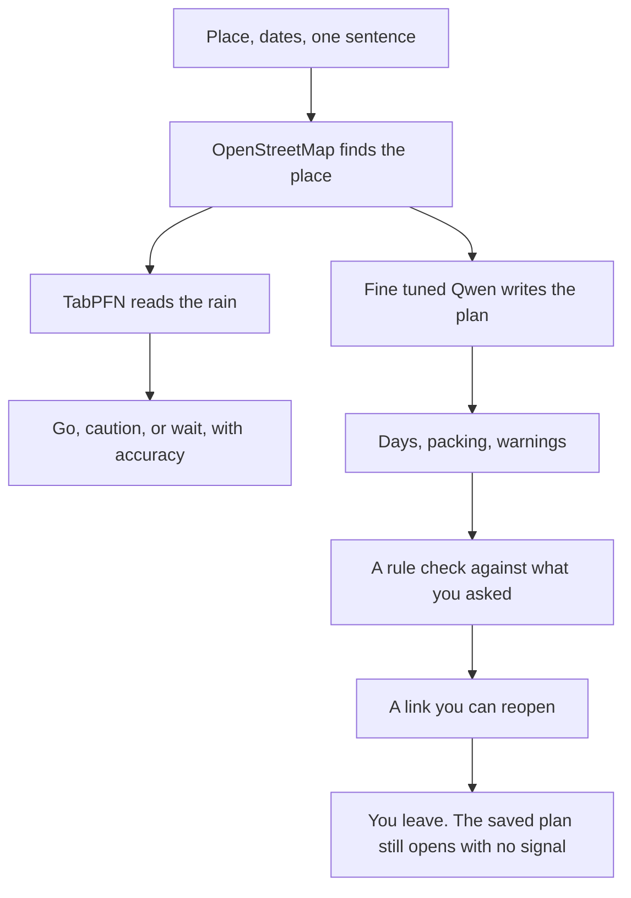
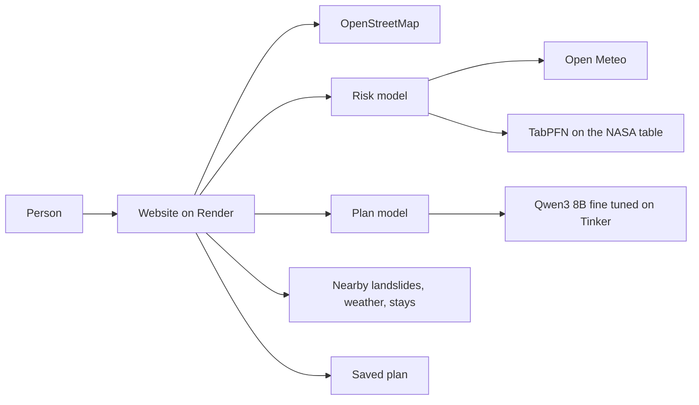
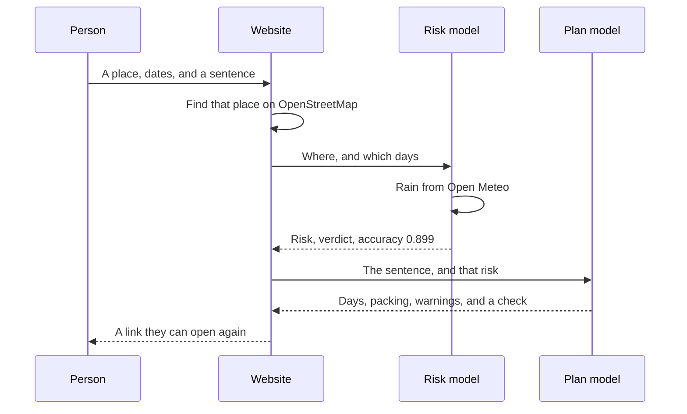
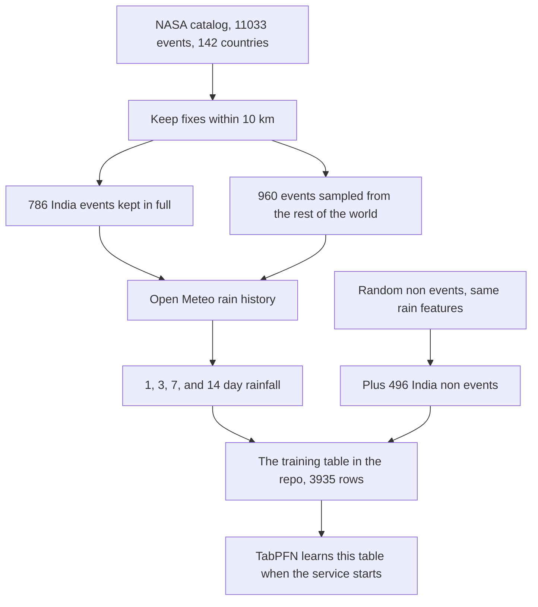
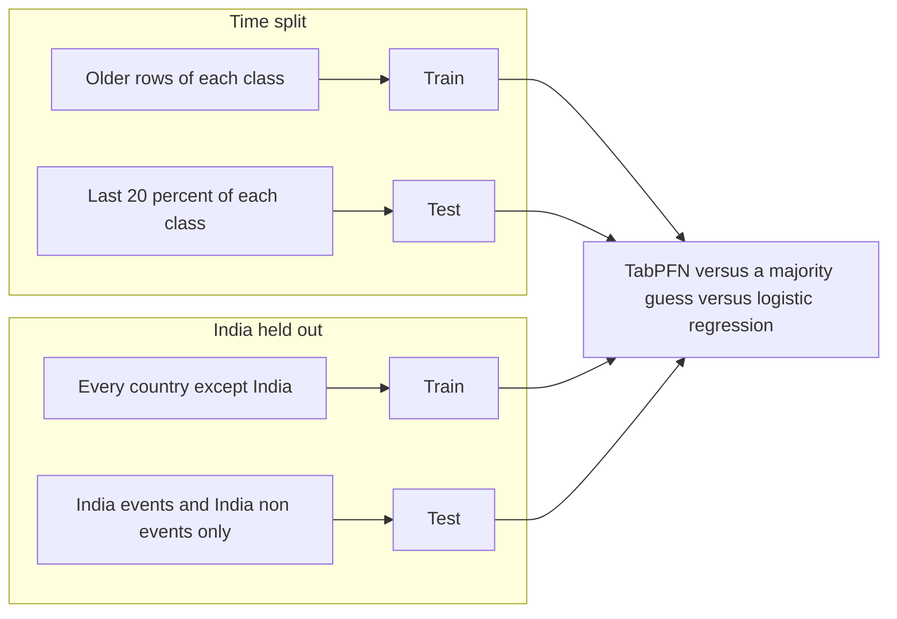
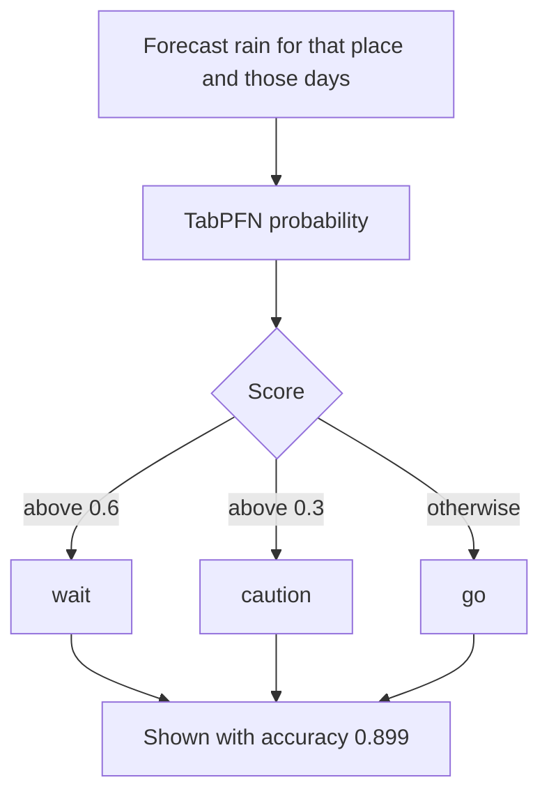
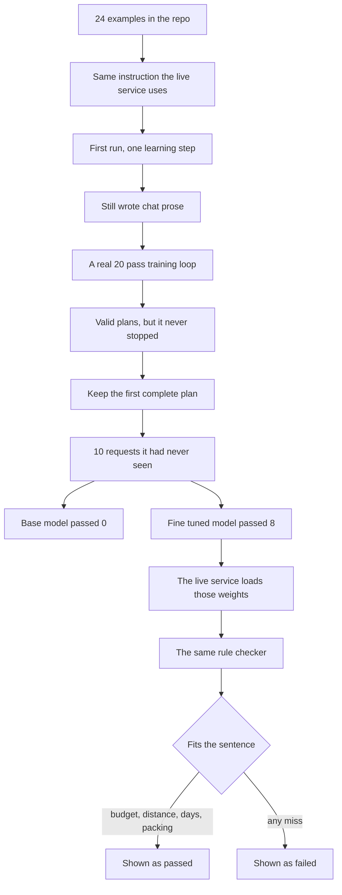
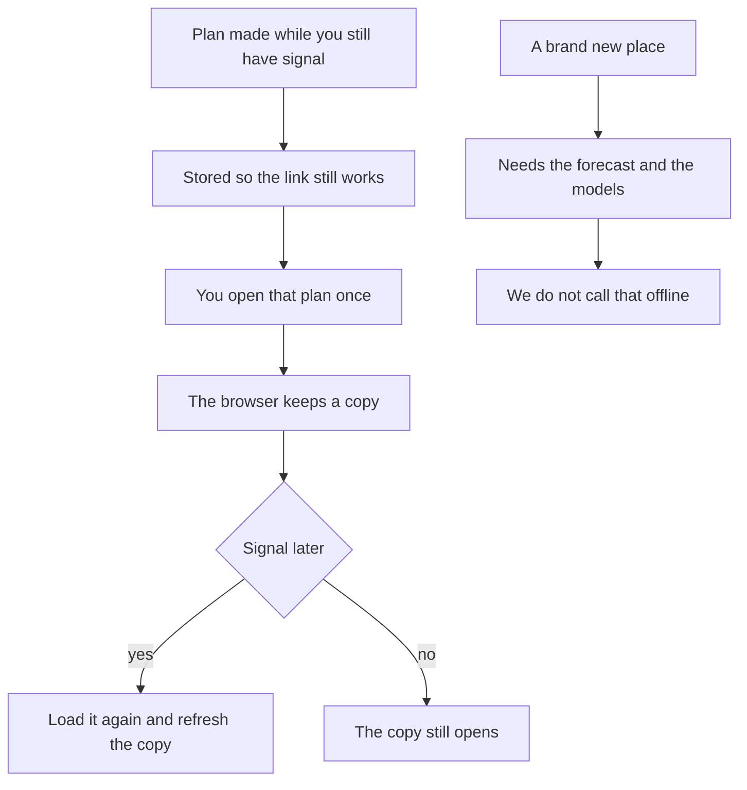

*This is a submission for the [Hacktoberfest Open-Source AI Challenge Week 1: Touch Grass](https://dev.to/challenges/hacktoberfest-week1-2026-10-05)*

Team: HONEYBEE

Ashwin Temkar ([@ashwintemkar](https://dev.to/ashwintemkar)) and Kiranraj Chintada ([@kiranrajchintada302](https://dev.to/kiranrajchintada302)).

## What We Built

OpenTrips answers one question before you leave the house. Should I go out this weekend?

You type a place, two dates, and a sentence about yourself. "Beginner, bad knee, budget 3000 rupees, wants hills." You get three things back.

1. A go, caution, or wait verdict for rain and landslide risk, with the model's measured accuracy on the screen.
2. A day by day outdoor plan and a packing list from a model we fine tuned for that job.
3. A map of recorded landslides nearby, the forecast grid, and places to stay, so you can leave with the plan instead of researching it.

The screen is the planning step. The point of the plan is to close the laptop. It is for anyone planning a walk, a day in the hills, or a camp, anywhere a forecast exists. It is not a hotel trip planner. The itinerary is trails, viewpoints, and short walks sized to ability. Stays on the map are context, not the product.

| | |
| --- | --- |
| Product | Outdoor go or wait, plus a plan and a packing list |
| Risk model | TabPFN on real NASA landslide events |
| Plan model | Qwen3 8B, fine tuned on Tinker |
| Weather and rain history | Open Meteo, no API key |
| Maps | OpenStreetMap and Leaflet |
| Hosting | Render, the model service and the website |
| Saved plans | Postgres, reopen by link, cached for no signal |
| Code | https://github.com/ashwintemkar/opentrips |

| Split | Majority guess | Logistic regression | TabPFN |
| --- | --- | --- | --- |
| Time, last 20 percent of each class | 0.556 | 0.799 | 0.914 accuracy, 0.972 AUC |
| Geography, India never seen in training | 0.390 | 0.821 | 0.899 accuracy, 0.956 AUC |

The plan model, on 10 requests it never saw in training: base model 0 of 10, fine tuned model 8 of 10. Both comparisons are rerunnable from this repo. `train_tabpfn.py` prints the risk table. `compare_plans.py` prints the plan table.

## Demo

Video: PASTE_YOUTUBE_URL

Live app: PASTE_LIVE_URL

The free Render instance can take about half a minute to wake up the first time you open it.

### Screenshots

## Code



https://github.com/ashwintemkar/opentrips

The numbers in this post come from that repo, not from a slide. Open these if you want to check them.

| In the repo | What it holds |
| --- | --- |
| `landslide_dataset.csv` | 3,935 training rows, real events and non events, with rainfall |
| `train_tabpfn.py` | The time split and the India held out split, against both baselines |
| `train_plan_model.py` | The Tinker fine tune of Qwen3 8B |
| `compare_plans.py` | Base model versus fine tuned model on the 10 held out requests |
| `plan_examples.jsonl` | The 24 outdoor examples the plan model learned from |
| `rule_checker.py` | The budget and distance check the live plan runs through |
| `frontend/` | The form, the results, the map, and the saved plan page |

## How I Built It

Kiran built the website people touch. I built the data, the TabPFN risk model, the Tinker fine tune, and the service that answers the website. Open Meteo and OpenStreetMap sit in the middle. Neither needs a paid key.

### TabPFN, on recorded events

The training table is the NASA Global Landslide Catalog plus rainfall from the Open Meteo archive. The raw export has 11,033 events in 142 countries. We kept events located within 10 km, kept all 786 India events that passed that filter, and sampled the rest down for runtime. Each event gets 1 day, 3 day, 7 day, and 14 day rainfall ending on the event date. Non events are random places and dates run through the same rainfall pipeline, plus 496 extra India non events so a held out India test actually contains both classes.

That table is `landslide_dataset.csv` in the repo. 3,935 rows. The result is not a claim you have to take on faith.

When you ask, the service reads the live forecast for those same rainfall windows and asks TabPFN how likely a landslide style event is. Above 0.6 is wait. Above 0.3 is caution. Otherwise go. The number on the card is the geography split, 0.899. Precision and recall stay blank, because we did not compute them.

The first evaluation runs looked strong and were wrong. One split had no India non events, so the model was mostly saying "event." We fixed the data and published the number from the fixed split. `train_tabpfn.py` is that run. The time split is stratified too. The last 20 percent of each class by date, not one global sort that dumped almost all of one class into the test slice.

### Tinker, on an open weight model

The plan is not a second call to a general chat model. The base model is Qwen3 8B, which is open weight. We fine tuned a small adapter on Tinker. Rank 16.

Training data is 24 hand written examples in `plan_examples.jsonl`. Places include India, the US, the UK, Switzerland, Nepal, Japan, Peru, New Zealand, Kenya, France, Iceland, and South Africa. Constraints include a bad knee, asthma, an elderly parent, a toddler, fear of heights, and pregnancy. The instruction in front of every example is the same instruction the live service uses. That file is `prompt_format.py`.

The first run was a single gradient step. The model still wrote chain of thought and ignored the JSON. A 20 epoch loop in `train_plan_model.py` fixed that. The model then repeated the answer until it hit the length limit, because it never learned to stop. We keep the first complete JSON object instead of training again.

`rule_checker.py` scores each plan. Valid JSON, at least one day, a packing list, budget at or under the number in the sentence, and distance per day inside a cap inferred from words like beginner or advanced. The live service runs that same checker before it answers. A pass is not hardcoded.

| | Pass rate |
| --- | --- |
| Base Qwen3 8B | 0 of 10 |
| Fine tuned model | 8 of 10 |

`compare_plans.py` is the script that produced that table. The weights the service actually loads are the Tinker sampler checkpoint `opentrips-plan-v1`. We called the live service with that checkpoint loaded and got a real plan back, not an error that the weights were missing.

### What the website does around those two models

The form finds the place on OpenStreetMap, then asks the risk model and the plan model. The results page shows the verdict, the accuracy, the itinerary, and a map. The map layers are nearby NASA landslide points, a weather grid, and stays ranked by distance and by how close they sit to a recorded landslide. Kiran's map and insight code is in `frontend/`.

A plan can be saved and reopened by link. A page you already opened is cached, so that plan still loads with no signal.

That is the offline behavior. The models do not run on the phone in the forest. The plan is made before you leave, then kept.

## Why Does Open Innovation Matter?

A closed chat model can write a pleasant itinerary. It cannot show a measured error rate on landslide records it was never trained on, and you cannot ship the training table next to the code.

| Closed default | What open made possible |
| --- | --- |
| Ask a hosted chat model if the weekend looks fine | TabPFN on a public table of real events, committed in this repo |
| Labels the author wrote, then a model that copies them | Labels are recorded reports, with a majority baseline and a logistic regression baseline in `train_tabpfn.py` |
| One country, no held out region | Trained with India removed, tested only on India, 0.899 accuracy |
| A base model that chats | Fine tuned open weight Qwen3 8B that writes a plan, 8 of 10 versus 0 of 10 in `compare_plans.py` |
| Weather behind a paid key | Open Meteo, no key |
| Maps behind a paid vendor | OpenStreetMap |
| Swap the model and you rebuild the product | The table, the checker, and the website stay. The weights can change |

Qwen3 8B weights are public. Tinker let us change them for this task and keep the result. TabPFN let us treat a few thousand rows as a classifier without standing up a training cluster. The dataset is in the repo so someone else can rerun the comparison.

We do not claim the phone runs the model with no signal. A new plan needs the server, because the forecast and the models run there. The honest offline piece is the saved plan you already opened.

## Prize Categories

* Best Use of TabPFN. The risk score is TabPFN on historical landslide rows. The baselines are in the table above, and in `train_tabpfn.py`. Accuracy 0.899 is on every result.
* Best Use of Tinker. Qwen3 8B fine tuned to write the plan. Held out pass rate 8 of 10 against 0 of 10 for the base model, from `compare_plans.py`. The live service loads that fine tune.
* Best Use of Render. The model service and the website are both hosted on Render.

Thanks for reading. If the verdict says go, close the tab.
